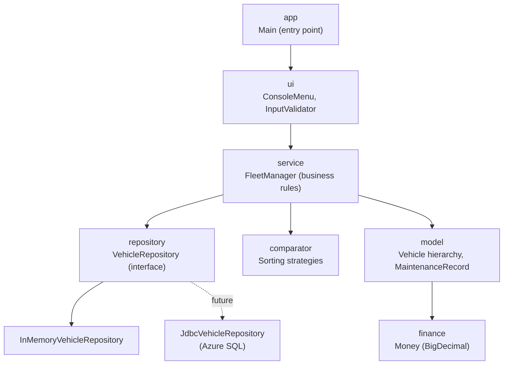
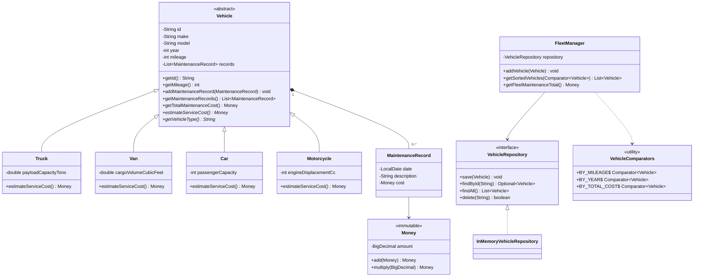

# Terminal Fleet Tracker

A console-based fleet and maintenance management system written in Java 17.
It tracks a mixed fleet of vehicles, logs maintenance work, calculates costs with
exact decimal arithmetic, and produces sorted reports, all from a validated,
crash-resistant terminal interface.

The project is built to simulate an enterprise engineering workflow: layered
architecture, strict encapsulation, polymorphism, pluggable sorting strategies,
unit testing, and incremental version control.

> **Status:** 🚧 In active development. The checklist below shows what is implemented.

---

## Features

| Feature | Status |
|---|---|
| Project skeleton, Maven build, architecture docs | ✅ Done |
| Vehicle hierarchy (Truck, Van, Car, Motorcycle) | ⬜ Planned |
| Maintenance records per vehicle | ⬜ Planned |
| Precision cost tracking with `BigDecimal` | ⬜ Planned |
| Polymorphic maintenance cost calculation | ⬜ Planned |
| Sorting by mileage, year, cost, and more via `Comparator` | ⬜ Planned |
| In-memory repository | ⬜ Planned |
| Validated console menu (never crashes on bad input) | ⬜ Planned |
| JUnit 5 test suite | ⬜ Planned |
| Optional: Azure SQL persistence via JDBC | ⬜ Future |

---

## Architecture Overview

The system uses a **layered architecture**. Each layer depends only on the layer
directly beneath it, so changes stay local.



| Package | Responsibility |
|---|---|
| `app` | Starts the program and wires the layers together. No logic. |
| `ui` | Menus, formatted output, input validation. Talks **only** to the service layer. |
| `service` | Business rules, fleet-wide calculations, and coordinating the repository. |
| `repository` | Storage abstraction. Hides *how* data is stored from the rest of the app. |
| `model` | Domain objects and their behavior. |
| `comparator` | Interchangeable sort orders, kept apart from the model. |
| `finance` | Immutable money type for exact currency arithmetic. |
| `exception` | Domain-specific error types. |

---

## Class Diagram (planned design)

> This diagram is the target design. It will be updated as each class is built.



Methods marked with `*` are **abstract hooks**: `Vehicle` defines *when* they are
called, and each subclass defines *how* the value is calculated.

---

## Design Decisions & Trade-offs

### 1. `Vehicle` is an abstract class, not an interface
All vehicles share real **state** (id, mileage, maintenance history) and real
**behavior** (adding records, totaling costs). An abstract class lets that shared
code live in one place, while abstract methods force each subclass to supply its
own cost logic.
*Trade-off:* Java allows only single inheritance, so a vehicle can't extend
another base class. For a clear "is-a" hierarchy like this one, that limit is acceptable.

### 2. Money uses `BigDecimal`, never `double`
`double` is binary floating point: `0.1 + 0.2` evaluates to `0.30000000000000004`.
Over thousands of maintenance entries those errors add up, which is unacceptable
for financial data. All currency goes through an immutable `Money` wrapper around
`BigDecimal` with an explicit rounding mode (`HALF_EVEN`, also called "banker's rounding").
*Trade-off:* the code is more verbose (`a.add(b)` instead of `a + b`) and slightly
slower, in exchange for exact results.

### 3. Sorting with `Comparator`s, not `Comparable`
`Comparable` builds a single "natural order" into the class itself. A fleet needs
*many* orders (by mileage, year, cost), and new ones shouldn't require editing
`Vehicle`. Separate `Comparator` objects follow the **Open/Closed Principle**:
open for extension, closed for modification. They can also be chained
(`BY_YEAR.thenComparing(BY_MILEAGE)`).
*Trade-off:* sort logic lives in a separate class, so there is one more file to look at.

### 4. Strict encapsulation
Every field is `private`. Mutable collections are never handed out directly;
getters return unmodifiable views (`List.copyOf` / `Collections.unmodifiableList`),
so outside code can't bypass validation by editing a list it was given.
*Trade-off:* changes must go through explicit methods, which is exactly the point.

### 5. In-memory storage behind a repository interface
Data is currently stored in memory (a `HashMap`) and is lost when the program
exits. This was a deliberate choice:
- the project runs immediately after cloning, with no credentials or setup;
- development can focus on object-oriented design before persistence concerns.

The key point is that the service layer depends on the **`VehicleRepository`
interface**, not on a `HashMap`. A future `JdbcVehicleRepository` backed by Azure
SQL can be swapped in **without modifying the service or UI layers** (the
Dependency Inversion Principle).
*Trade-off:* no persistence between runs for now.

### 6. A console UI that never crashes on bad input
All input goes through a validation layer that re-prompts on invalid data
(letters where a number is expected, negative costs, unknown IDs) instead of
throwing an uncaught exception. The UI layer contains no business logic, so it
could be replaced with a GUI or REST API later.

---

## Getting Started

### Prerequisites
- Java 17+
- Maven 3.8+ (bundled with IntelliJ IDEA)

### Build & Test
```bash
mvn clean test
```

### Run
*Instructions will be added once the entry point is implemented.*

---

## Project Structure

```
terminal-fleet-tracker/
├── pom.xml
├── README.md
└── src/
    ├── main/java/com/fleettracker/
    │   ├── app/          # Entry point
    │   ├── model/        # Vehicle hierarchy & maintenance records
    │   ├── finance/      # Money value object
    │   ├── comparator/   # Sorting strategies
    │   ├── repository/   # Storage abstraction
    │   ├── service/      # Business logic
    │   ├── ui/           # Console interface
    │   └── exception/    # Custom exceptions
    └── test/java/com/fleettracker/   # JUnit 5 tests (mirrors main)
```

---

## Roadmap

1. ✅ Project skeleton & architecture documentation
2. ⬜ `Money` value object + unit tests
3. ⬜ `MaintenanceRecord` + abstract `Vehicle`
4. ⬜ Vehicle subclasses with polymorphic cost hooks
5. ⬜ Repository interface + in-memory implementation
6. ⬜ `FleetManager` service
7. ⬜ Comparators & sorted reports
8. ⬜ Console UI with input validation
9. ⬜ Polish, full test coverage, demo GIF
10. ⬜ *(Stretch)* Azure SQL persistence via JDBC
